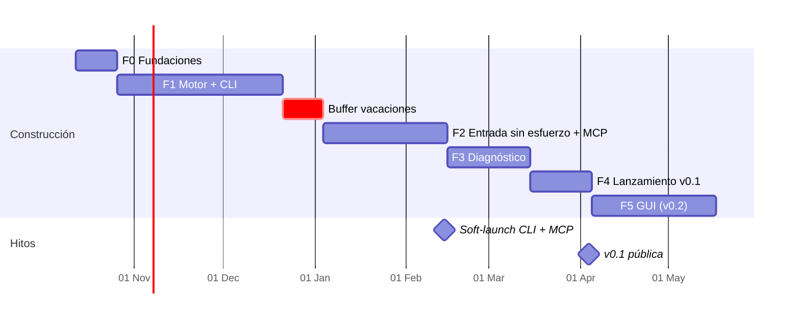

# Roadmap — Load Tester en Rust (motor + CLI + MCP + diagnóstico)

Oct 7, 2026 · @Gonzalo · **Estado: en planificación** (este documento se rompe y se rearma las veces que haga falta)

> Nombre del binario provisorio en todo el documento: `lt`. Carpeta en el repo del usuario: `.loadtest/`.

## Visión, misión y principios

En 6 meses, una herramienta open source que uso en mi trabajo para hacer pruebas de carga sin armar un proyecto por cada test, y que me posiciona como su creador ante empleadores del exterior.

**Visión:** pasar de "tengo una API" a "sé dónde se rompe y por qué" con el mínimo esfuerzo posible. Tan fácil como mandar un request en Bruno, con el rigor estadístico de k6 y un diagnóstico que apunta al código.

**Misión del primer año:** que un desarrollador, partiendo de su repo, de una documentación pegada o de una descripción en lenguaje natural:

1. tenga una prueba de carga confiable diseñada en menos de 5 minutos,
2. la ejecute con una sola aprobación consciente,
3. reciba hallazgos concretos con evidencia ("`POST /orders` se degrada desde 180 RPS; los timeouts empiezan cuando el pool de conexiones se agota") y, si el agente tiene acceso al código, sugerencias de dónde mirar.

**El ciclo completo que resuelve la herramienta:**

```
Entrada            Diseño              Aprobación        Ejecución        Diagnóstico            Sugerencias
(repo, OpenAPI, -> (CLI import/init -> (humano,        -> (motor Rust,  -> (motor de hallazgos -> (agente + código
 curl, doc,         o agente vía MCP)    un comando)       métricas)        determinista)          del proyecto)
 descripción)
```

**Principios de producto (no negociables):**

1. **La IA diseña y analiza; la persona autoriza la carga.** Ningún agente puede disparar carga sin una acción humana deliberada. Todo escenario creado o modificado por un agente queda en `draft` y cualquier cambio invalida la aprobación previa. La única excepción es el *smoke check*: un request por paso, en serie, solo contra loopback, para que el agente verifique que su escenario funciona. El modelo de amenaza está escrito (ver ADR-004) y dice explícitamente qué se protege y qué no.
2. **Números en los que se puede confiar.** Sin coordinated omission, percentiles con HdrHistogram y aviso cuando el propio generador es el cuello de botella. Si los números no son confiables, el diagnóstico tampoco.
3. **Hallazgos con evidencia, no opiniones.** El motor detecta patrones de forma determinista y adjunta la evidencia (ventana de tiempo, endpoint, métricas). El agente propone hipótesis sobre el código, y siempre quedan marcadas como hipótesis.
4. **Esfuerzo mínimo de entrada.** Si hay un OpenAPI, una colección o un curl, el usuario no debería tipear un escenario a mano.
5. **Un motor, varias interfaces.** CLI, MCP y (más adelante) GUI usan el mismo binario. Ninguna interfaz contiene lógica de carga ni de diagnóstico.
6. **Local-first y archivos abiertos.** Escenarios en YAML/JSON versionables en Git, dentro del repo del proyecto. Sin cuentas ni nube.
7. **Agnóstico de proveedor de IA.** MCP estándar (tools, resources y prompts); funciona con Claude Code, Cursor o cualquier cliente MCP.
8. **Uso propio primero.** Cada fase termina cuando la uso en un caso real, no cuando el código compila.

## Experiencia objetivo: tres caminos de entrada

Esta sección es la especificación de producto. Si una tarea del roadmap no acerca alguno de estos tres caminos, va al backlog.

**Camino A — CLI en el repo (sin IA)**

```bash
cd mi-api
lt init                      # detecta openapi.yaml / swagger.json, base URL y entornos
                             # crea .loadtest/ con un escenario smoke y uno de carga
lt approve smoke             # muestra hosts, RPS máximo y duración; pide confirmación
lt run smoke                 # ejecuta, imprime resumen y hallazgos
lt report latest --open      # reporte HTML autocontenido
```

**Camino B — Agente con MCP (diseño a medida)**

```bash
lt mcp install claude-code   # escribe la config MCP del proyecto
```

> "Mirá el código de este servicio y armame una prueba que simule el checkout con 200 usuarios."

El agente lee el código o la doc, llama a `create_scenario` y el escenario queda en `draft`. Cada request queda anotado con su origen en el código (`source: src/orders/handler.rs:create_order`). La persona corre `lt approve checkout` y `lt run checkout`. Después el agente llama a `get_findings` y cruza los hallazgos con el código.

**Camino C — Pegar lo que tengo**

```bash
lt import curl  < request.txt
lt import openapi https://api.ejemplo.com/openapi.json
lt import postman coleccion.json
```

O, vía agente, pegar un fragmento de documentación o un JSON de ejemplo en el chat: el agente usa `import_spec` o `create_scenario` con ese contenido.

**Salida común a los tres caminos:** resultados en `.loadtest/runs/<id>/` (gitignored), hallazgos en `findings.json`, resumen compacto para LLM y reporte HTML.

## Objetivos y métricas de éxito (OKRs a 6 meses)

Tres objetivos, en orden de prioridad: si hay que sacrificar algo, se sacrifica el 3 antes que el 1.

| Objetivo | Resultado clave medible | Fecha meta |
| --- | --- | --- |
| **O1. Resolver mi problema real** | Reemplazo al menos 3 pruebas de carga del trabajo que antes requerían un proyecto aparte | Fin de Fase 1 |
|  | Desde un repo con OpenAPI, primera prueba ejecutada en menos de 5 minutos (camino A) | Fin de Fase 2 |
|  | Escenario a medida diseñado por el agente, de cero a ejecutado, en menos de 10 minutos (camino B) | Fin de Fase 2 |
|  | El diagnóstico identifica la causa correcta en al menos 4 de 5 patologías del laboratorio y en 1 caso real del trabajo | Fin de Fase 3 |
| **O2. Producto open source creíble** | v0.1 (CLI + MCP + diagnóstico) publicada con binarios para Linux, macOS y Windows | Fin de Fase 4 |
|  | Benchmark reproducible publicado contra k6 y oha (memoria por VU y precisión de RPS) | Fin de Fase 4 |
|  | Cobertura de tests del motor ≥ 70% y CI en verde | Continuo |
| **O3. Visibilidad profesional** | 3 artículos técnicos publicados en inglés | Fin de Fase 4 |
|  | 1 charla (meetup o virtual) sobre el proyecto | Fin de Fase 5 |
|  | Proyecto destacado en CV, LinkedIn y gonzalomartinez.tech, con demo en video | Fin de Fase 4 |
|  | 300 estrellas en GitHub y 3 contribuidores externos | 3 meses post-lanzamiento |

Las estrellas son una señal, no la meta: un proyecto con 80 estrellas que uso a diario y explico bien en una entrevista vale más que uno con 1.000 abandonado.

## Capacidad y cadencia de trabajo

El plan asume 8 a 10 horas por semana, compatibles con dos trabajos (unas 225 h hasta la v0.1). Si la capacidad real es menor, se estiran las fechas; no se recorta la calidad del motor.

**Bloques semanales sugeridos:**

- 2 noches de semana × 2 h: tareas chicas y cerradas (un test, un comando, un fix).
- 1 bloque de fin de semana × 4–6 h: tareas de diseño o de mayor concentración.

**Sprints de 2 semanas, con tres rituales:**

| Ritual | Cuándo | Duración | Salida |
| --- | --- | --- | --- |
| Planificación | Domingo de inicio de sprint | 30 min | 3 a 5 tareas elegidas del backlog, cada una de máximo 4 h |
| Revisión semanal | Cada domingo | 15 min | Qué terminé, qué me trabó, ajuste del sprint |
| Retro + demo | Domingo de cierre de sprint | 30 min | Un GIF o video corto de lo nuevo + una nota de aprendizaje |

**Reglas de operación:**

- Ninguna tarea mayor a 4 horas: si lo es, se parte al planificar el sprint.
- Cada sprint termina con algo demostrable, aunque sea por terminal.
- Las notas de aprendizaje alimentan los artículos técnicos de O3.
- Issues y commits en inglés desde el día 1.

## Vista general del roadmap

Cinco fases en unas 25 semanas hasta la v0.1 (CLI + MCP + diagnóstico). La GUI pasa a ser la v0.2.



Cada fase cierra con un gate (G0 a G4): no se pasa a la siguiente sin cumplirlo. El soft-launch de febrero asegura algo mostrable aunque el diagnóstico se demore.

## Arquitectura (borrador)

```
crates/
  engine-core     scheduler, executors, VUs, detección de saturación
  driver-http     cliente sobre hyper con medición de timings por fase
  scenario        modelo, JSON Schema (schemars), interpolación, validación, aprobación
  importers       openapi, curl, postman, bruno, har -> scenario
  metrics         HdrHistogram por endpoint/tag, series temporales por ventana
  diagnose        motor de hallazgos determinista (reglas + evidencia)
  report          NDJSON, resumen para LLM, HTML autocontenido
  mcp             servidor MCP (rmcp): tools, resources, prompts
  cli             binario `lt`
tools/
  lab-server      servidor axum con patologías configurables (ver Fase 1)
```

**En el repo del usuario:**

```
.loadtest/
  config.yaml          entornos, allowlist de hosts, límites duros
  scenarios/*.yaml     versionados en Git
  approvals/           firmas de aprobación (ver ADR-004)
  runs/                resultados (gitignored)
```

## Fase 0 — Fundaciones (12 oct – 25 oct 2026, 2 semanas)

Objetivo: dejar decidido todo lo que es caro de cambiar después, y aprender exactamente el Rust que la Fase 1 necesita.

**Sprint 0 — Decisiones y repositorio**

- [ ] Elegir nombre (verificar disponibilidad en crates.io, GitHub y dominio .dev o .io)
- [ ] Crear repo público con licencia dual MIT/Apache-2.0, README de visión y CONTRIBUTING mínimo
- [ ] Armar el Cargo workspace vacío con los crates de la arquitectura
- [ ] CI en GitHub Actions: `cargo fmt`, `clippy` y `test` en Linux (macOS y Windows en una segunda tarea)
- [ ] ADR-001: motor único, interfaces delgadas
- [ ] ADR-002: formato de escenario (YAML principal, JSON Schema como contrato). Borrador en [`adr/ADR-002-formato-escenario.md`](adr/ADR-002-formato-escenario.md)
- [ ] Elegir crate de YAML (`serde_yaml` está archivado) que reporte línea y columna de cada error
- [ ] ADR-003: `hyper` directo en lugar de `reqwest`, para medir DNS, connect, TLS y TTFB por separado
- [ ] ADR-004: modelo de amenaza de la aprobación (qué puede y qué no puede hacer un agente con shell), qué se firma (escenario + entorno resuelto) y reglas del smoke check
- [ ] Dejar por escrito el acuerdo con el trabajo: proyecto personal, uso interno con visto bueno, nada interno en el repo

**Sprint 0 — Rust dirigido (en paralelo)**

- [ ] Capítulos de ownership, traits, error handling y async del libro oficial; solo lo necesario
- [ ] Tutorial de tokio: tasks, channels (`mpsc`, `watch`), `select!`
- [ ] Spike descartable: cliente sobre `hyper` que dispara N requests concurrentes y mide timings por fase
- [ ] Spike descartable: scheduler de tasa constante que mide la latencia desde el instante *planificado* (no desde el envío real) y carga los resultados en `hdrhistogram`

**Gate G0:** el spike mide 10.000 requests contra un servidor local, los percentiles coinciden con los de `oha` dentro de un margen razonable y el scheduler mantiene la tasa pedida aunque el servidor se frene.

## Fase 1 — Motor + CLI (26 oct – 20 dic 2026, 8 semanas)

Objetivo: dejar de armar un proyecto por cada prueba de carga. Al final de esta fase, la herramienta ya se usa en el trabajo desde la terminal.

**Sprint 1 (26 oct – 8 nov) — Modelo de escenario**

- [ ] Tipos del modelo según ADR-002: `setup`, `flows` con `weight`, pasos, checks, `load` y thresholds; campos desconocidos son error (salvo `x-`)
- [ ] `config.yaml`: entornos, `allowed_hosts`, límites duros y `secrets` declarados
- [ ] Encadenamiento de requests: `extract` por JSON path, header o regex (por ejemplo, login → token)
- [ ] Generar el JSON Schema desde los tipos Rust (`schemars`)
- [ ] Interpolación `{{var}}` con preservación de tipo, `{{env.X}}` y placeholders dinámicos: `$uuid`, `$timestamp`, `$randomInt`
- [ ] Comando `validate` con errores que señalan la ruta exacta del campo y lista los `todo` pendientes
- [ ] Hash canónico del escenario + entorno resuelto (la aprobación es derivada, no un campo del archivo)

**Sprint 2 (9 nov – 22 nov) — Executors y laboratorio**

- [ ] `Constant VUs` con duración fija y `gracefulStop`
- [ ] `Constant Arrival Rate` con scheduler propio que no espera respuestas (sin coordinated omission)
- [ ] `Ramping Arrival Rate` por escalones: base para detectar el punto de quiebre en la Fase 3
- [ ] Métrica de iteraciones descartadas y detección de saturación del generador, con advertencia visible
- [ ] `lab-server`: servidor axum con latencia, errores y patologías configurables (pool chico, endpoint lento, fuga de memoria, rate limit)
- [ ] Tests de integración del motor contra `lab-server`

**Sprint 3 (23 nov – 6 dic) — Métricas**

- [ ] Desglose de timings HTTP con `hyper`: DNS, connecting, TLS, sending, waiting (TTFB), receiving
- [ ] HdrHistogram por endpoint y por tag; p50, p90, p95, p99, p99.9, min, max
- [ ] Series temporales por ventana de 1 s (latencia, RPS, errores): son la materia prima del diagnóstico
- [ ] Tasa de error por código de estado y por tipo de fallo de red (timeout, reset, refused)
- [ ] Checks no bloqueantes (status, header, JSON path, regex) y thresholds con resultado pasa/falla

**Sprint 4 (7 dic – 20 dic) — CLI y reportes**

- [ ] `run` con salida en terminal legible y `--output json-stream` (NDJSON versionado)
- [ ] Resultados persistidos en `.loadtest/runs/<id>/`
- [ ] Códigos de salida: 0 pasa, uno para thresholds fallidos, otro para errores de configuración
- [ ] Salida condensada de fallos agrupada por firma de error
- [ ] Reporte HTML autocontenido con gráficos de latencia y RPS por endpoint
- [ ] `approve` interactivo (versión inicial) y `run` que rechaza escenarios sin aprobación válida
- [ ] `check`: smoke check (setup + cada flow una vez, 1 VU, ignora `load`)

**Gate G1:** usé la herramienta en 3 pruebas reales del trabajo y los percentiles son consistentes con k6 en el mismo escenario.

## Fase 2 — Entrada sin esfuerzo + MCP (4 ene – 14 feb 2027, 6 semanas)

Objetivo: que nadie tenga que escribir un escenario a mano. Por CLI se importa lo que ya existe; por MCP el agente diseña a medida desde el código, la doc o una descripción, sin poder ejecutar nada. Antes arranca un buffer de vacaciones del 21 dic al 3 ene, sin tareas comprometidas.

**Sprint 5 (4 ene – 17 ene) — Importadores e `init`**

- [ ] `import openapi` (archivo o URL): un request por operación, bodies de ejemplo generados desde el schema, `source` desde `operationId`
- [ ] `import curl` (archivo o stdin)
- [ ] `import postman` y `import bruno`
- [ ] `init`: detecta specs OpenAPI en el repo, propone base URL y entorno local, y genera un escenario smoke y uno de carga
- [ ] Los escenarios importados nacen en `draft`, igual que los del agente

**Sprint 6 (18 ene – 31 ene) — Servidor MCP**

- [ ] Subcomando `mcp` por stdio con el SDK oficial de MCP para Rust (`rmcp`)
- [ ] Tools de diseño: `list_scenarios`, `get_scenario`, `create_scenario`, `update_scenario`, `validate_scenario`, `import_spec` (acepta texto pegado: OpenAPI, curl, HAR), `create_environment`
- [ ] Tool `smoke_check`: solo si todos los hosts resuelven a loopback, sin seguir redirecciones fuera de loopback; devuelve estado por paso, checks y cuerpos truncados
- [ ] Tools de lectura: `list_runs`, `get_run_results`, `compare_runs`
- [ ] Resources: `metrics://runs/{id}`, `metrics://latest`, `config://environments` con secretos redactados, `schema://scenario`
- [ ] Prompts MCP: `design_load_test` (desde código, doc o descripción) que guía al agente a completar `source` y `tags`
- [ ] `mcp install claude-code|cursor` escribe la configuración del proyecto

**Sprint 7 (1 feb – 14 feb) — Aprobación, guardas y flujo real**

- [ ] Aprobación según ADR-004: firma HMAC del escenario con clave en el keyring del sistema, confirmación que exige TTY real y que la persona tipee el host destino
- [ ] `approve` muestra el resumen de riesgo: hosts destino, RPS máximo, duración, entorno y diff desde la última aprobación
- [ ] Allowlist de hosts por entorno y límites duros de RPS, VUs y duración en `config.yaml`
- [ ] Tests automáticos de la guarda: editar el YAML, recalcular hashes o pasar "y" por un pipe no habilita la ejecución
- [ ] Grabar demo: "leé el código de este servicio y armame un spike" → aprobación humana → ejecución → análisis

**Gate G2:** desde un repo con OpenAPI llego a la primera prueba en menos de 5 minutos; creé un escenario a medida con el agente en menos de 10; y la guarda resiste los ataques documentados en ADR-004.

**Hito de visibilidad:** soft-launch de la CLI + MCP (README con demo, post en LinkedIn). Llega antes de la búsqueda laboral fuerte.

## Fase 3 — Diagnóstico (15 feb – 14 mar 2027, 4 semanas)

Objetivo: que los resultados digan qué falla y dónde, no solo cuánto tarda. El motor detecta y prueba; el agente, que ve el código, explica y sugiere.

**Catálogo inicial de hallazgos (reglas deterministas):**

| Hallazgo | Señal en las métricas | Causas probables a sugerir |
| --- | --- | --- |
| Punto de quiebre | El p99 crece de forma no lineal y el RPS se aplana a partir de cierto escalón | Saturación de CPU, pool de conexiones o lock compartido |
| Cola larga | p99 / p50 muy alto con la carga estable | Queries lentas ocasionales, GC, contención |
| Degradación en el tiempo | La latencia sube a carga constante | Fuga de memoria, colas que crecen, tablas sin índice que crecen |
| Errores por umbral | 5xx, 429 o timeouts que aparecen desde cierto RPS | Rate limiter, pool agotado, proxy con límite |
| Problemas de conexión | `connecting` o `TLS` altos, resets o refused | Sin keep-alive, backlog chico, límite de file descriptors |
| Servidor vs payload | TTFB alto vs receiving alto | Procesamiento en servidor vs respuestas demasiado grandes |
| Contagio entre endpoints | Un endpoint se degrada y arrastra a otros | Recurso compartido (DB, pool, thread pool) |
| Resultado inválido | Generador saturado o iteraciones descartadas | Repetir con más recursos o menos carga; no sacar conclusiones |

**Sprint 8 (15 feb – 28 feb) — Motor de hallazgos**

- [ ] Crate `diagnose`: cada hallazgo tiene id, severidad, endpoint, ventana de tiempo, métricas de evidencia y causas probables
- [ ] Implementar las reglas del catálogo sobre las series temporales del Sprint 3
- [ ] Perfil `breakpoint`: rampa por escalones que corta sola cuando detecta el quiebre
- [ ] Comparación contra una corrida base: regresiones por endpoint con significancia mínima
- [ ] Validación: cada patología de `lab-server` dispara el hallazgo correcto

**Sprint 9 (1 mar – 14 mar) — Diagnóstico asistido**

- [ ] Resumen post-test compacto para LLM (Markdown/JSON con presupuesto de tokens; métricas y hallazgos, nunca cuerpos de respuesta)
- [ ] Tools MCP: `get_findings`, `explain_finding`
- [ ] Prompt MCP `diagnose_run`: guía al agente a ir del hallazgo al `source` del endpoint, leer el código y proponer hipótesis marcadas como tales
- [ ] Sección de hallazgos en el reporte HTML y en la salida de terminal
- [ ] Probarlo en 1 caso real del trabajo y documentar el antes/después

**Gate G3:** en el laboratorio, el diagnóstico identifica la causa correcta en al menos 4 de 5 patologías; en un caso real, el agente llegó al punto del código responsable.

## Fase 4 — Lanzamiento público v0.1 (15 mar – 4 abr 2027, 3 semanas)

Objetivo: convertir el proyecto en algo que otros encuentran, entienden en 30 segundos y prueban.

**Sprint 10 (15 mar – 28 mar) — Preparación**

- [ ] Instalación en un comando con `cargo-dist`: script shell, PowerShell y Homebrew
- [ ] README en inglés: problema, GIF de 20 segundos de los tres caminos, instalación y `lt init`
- [ ] Sitio de documentación (mdBook): guía de inicio, referencia del escenario, guía MCP, catálogo de hallazgos
- [ ] Benchmark reproducible contra k6 y oha, con scripts y resultados publicados
- [ ] 10 issues etiquetados "good first issue" (por ejemplo, nuevas reglas de diagnóstico) y plantillas de issue y PR
- [ ] Artículo 1: "Why AI shouldn't fire your load tests" (diseño human-in-the-loop y modelo de amenaza)
- [ ] Artículo 2: "Coordinated omission explained, and how to avoid it in Rust"
- [ ] Artículo 3: "From load test to root cause: deterministic findings + an agent that reads your code"

**Sprint 11 (29 mar – 4 abr) — Lanzamiento**

- [ ] Release v0.1.0 con binarios
- [ ] Publicar en crates.io, awesome-rust, r/rust y "Show HN" en Hacker News, en días distintos
- [ ] Post y video demo en LinkedIn; actualizar CV y gonzalomartinez.tech
- [ ] Responder issues y comentarios en menos de 48 h durante las dos semanas siguientes

**Gate G4:** v0.1 publicada, demo en el portfolio y al menos 10 personas externas la probaron (issues, estrellas o comentarios).

## Fase 5 — GUI con Tauri, v0.2 (abr – may 2027, 6 semanas)

Objetivo: la experiencia visual para quien no vive en la terminal. Acá jugás de local: React y TypeScript. El alcance se ajusta con lo que pidan los usuarios de la v0.1.

- [ ] App Tauri v2 + React/TS en `apps/desktop`; el motor corre como sidecar y emite el mismo NDJSON de la CLI
- [ ] Explorador de `.loadtest/` y pantalla "pegar curl / OpenAPI" (camino C sin terminal)
- [ ] Editor de requests y de perfiles de carga con validación en vivo contra el JSON Schema
- [ ] Revisión de borradores: diff de lo que cambió el agente, resumen de riesgo y botón Aprobar
- [ ] Dashboard en vivo y vista de hallazgos con la evidencia marcada sobre los gráficos
- [ ] Instaladores desde CI

**Gate G5:** una persona que no soy yo instala la app y ejecuta su primera prueba sin ayuda en menos de 15 minutos.

## Fase 6 — Expansión (continuo)

Objetivo: crecer según lo que pidan los usuarios reales, no según la especificación original. El orden es una apuesta inicial que se reordena con los issues.

| Prioridad | Iniciativa | Por qué |
| --- | --- | --- |
| 1 | GitHub Action oficial con comparación contra baseline | Regresiones de performance en cada PR; visibilidad en el marketplace |
| 2 | Correlación con métricas del servidor (OTLP, Prometheus, header `Server-Timing`) | El diagnóstico pasa de "dónde se nota" a "qué recurso se agota" |
| 3 | Importador HAR y detección de rutas en frameworks sin OpenAPI (Express, FastAPI, Spring, axum) | Más repos entran por el camino A |
| 4 | Datasets CSV/JSON con distribución secuencial, round-robin o aleatoria | Pedido frecuente en pruebas realistas |
| 5 | Perfiles spike y soak, Ramping VUs | Completa los perfiles de carga clásicos |
| 6 | HTTP/2 | Recortado de la Fase 1 para proteger el motor |
| 7 | Driver de Kafka | Encaja con mi experiencia y hay pocas herramientas buenas |
| 8 | WebSockets y gRPC dinámico | Protocolos de la especificación original |
| 9 | Sinks: Prometheus, InfluxDB, OTLP + dashboard de Grafana | Integración con observabilidad existente |
| 10 | Agente embebido como host MCP (Claude API u Ollama) | Para quien no usa un cliente MCP |
| 11 | Modo distribuido | Supera el límite de una sola máquina; posible open core |

## Visibilidad, marca personal y uso en el trabajo

La visibilidad se construye durante todo el proyecto, no solo en el lanzamiento: cada sprint deja una pieza mostrable.

**Construir en público**

- Post corto en LinkedIn cada 2 sprints con el GIF de la demo y un aprendizaje técnico.
- Repo público desde el día 1, con commits y issues en inglés.
- Las notas de retro se convierten en los artículos técnicos.

**En el trabajo**

1. Fase 1: usarla en pruebas reales y documentar los resultados (antes/después en tiempo invertido).
2. Fase 2: mostrar a tu equipo el flujo `init` y el del agente con el MCP de documentación; proponerla como herramienta interna.
3. Fase 3: un caso donde el diagnóstico llevó a un fix real es la mejor historia de entrevista.
4. Con el visto bueno, escribir un caso de uso anónimo para el blog del proyecto, sin datos internos.

**Para la búsqueda laboral en el exterior**

- Historia para entrevistas: problema propio → motor con números confiables → diseño seguro para agentes → diagnóstico que llega al código → adopción en el trabajo → comunidad.
- Roles donde más suma: SRE, Platform Engineer, Backend senior con foco en performance, DevTools.
- La charla en inglés es también práctica de speaking para las entrevistas.

## Riesgos, mitigaciones y criterios de corte

El riesgo número uno es abandonar por agotamiento; todas las demás mitigaciones dependen de proteger el ritmo.

| Riesgo | Señal temprana | Mitigación |
| --- | --- | --- |
| Agotamiento con dos trabajos | 2 sprints seguidos sin cerrar tareas | Bajar a 1 sprint cada 3 semanas; nunca abandonar sin decidirlo explícitamente |
| Curva de Rust más lenta de lo esperado | Gate G0 no se cumple en 3 semanas | Más tiempo en spikes; simplificar executors antes de recortar métricas |
| `hyper` a bajo nivel más costoso de lo previsto | El spike de timings no cierra en el Sprint 0 | Arrancar sin el desglose DNS/TLS (solo total y TTFB) y sumarlo en la Fase 3 |
| Alcance que crece | Tareas nuevas que no acercan ninguno de los tres caminos | Toda idea nueva va al backlog de la Fase 6, sin excepciones |
| Mediciones poco confiables | Diferencias grandes contra k6 u oha | Tests contra `lab-server` con latencia conocida; no lanzar sin el benchmark |
| Diagnósticos equivocados o alucinados | Hallazgos que no se reproducen o hipótesis presentadas como hechos | Reglas deterministas con evidencia; validación contra el laboratorio; hipótesis del agente siempre etiquetadas |
| Importador OpenAPI que no cubre specs reales | `$ref` circulares, `oneOf` o specs inválidas | Soportar un subconjunto documentado; avisar qué operaciones se saltearon y por qué |
| Agente que logra ejecutar | Algún camino sin aprobación humana | ADR-004 + tests automáticos de la guarda + revisión de seguridad antes de G2 |
| Conflicto de propiedad intelectual | Uso de horario o recursos laborales | Desarrollo fuera de horario; acuerdo escrito en Fase 0 |
| Datos sensibles hacia el LLM | Respuestas reales en resúmenes | Redacción por defecto; resúmenes con métricas, no con cuerpos completos |
| Mudanza que interrumpe el proyecto | Fechas de viaje o entrevistas intensas | El soft-launch de febrero ya deja algo mostrable |

**Orden de recorte si falta tiempo:**

1. Fase 6 entera.
2. Fase 5 (GUI): CLI + MCP + diagnóstico alcanzan como proyecto de portfolio.
3. Importadores Postman y Bruno (quedan OpenAPI y curl).
4. Comparación contra baseline en la Fase 3.
5. Desglose DNS/TLS de timings (quedan total y TTFB).

Lo que nunca se recorta: la exactitud de las métricas, la guarda que impide ejecutar al agente y la evidencia detrás de cada hallazgo.

## Decisiones abiertas

Cosas que hay que decidir antes de que se vuelvan caras. Cada una pasa al registro cuando se cierra.

| # | Pregunta | Recomendación actual | Decidir antes de |
| --- | --- | --- | --- |
| D2 | Nombre del proyecto y del binario | Corto, pronunciable en inglés, libre en crates.io y GitHub | Sprint 0 |
| D3 | Formato del escenario | Propuesta completa en el borrador de ADR-002: YAML declarativo, aprobación derivada por firma, flows con peso, `source` por paso | Fin de Sprint 0 |
| D4 | ¿El diagnóstico lee métricas del servidor en la v0.1? | No: solo lado cliente. La correlación con el servidor va a la Fase 6 | Fase 3 |

## Registro de decisiones y backlog futuro

Cada decisión importante queda registrada con fecha y motivo, para no volver a discutirla en cada sprint.

| Fecha | Decisión | Motivo |
| --- | --- | --- |
| 7 oct 2026 | El load tester es el proyecto principal; entity resolution queda en pausa | Resuelve un problema propio y diario, mayor probabilidad de terminarlo |
| 7 oct 2026 | El agente diseña y analiza; nunca dispara carga sin acción humana deliberada | Seguridad y control humano sobre el tráfico generado |
| 7 oct 2026 | Claude Code como orquestador MCP antes que agente embebido | Lectura de varios MCPs y del código sin construir un host propio |
| 7 oct 2026 | Orden: motor + CLI → entrada sin esfuerzo + MCP → diagnóstico → GUI | El valor está en el ciclo "entrada → hallazgo"; la GUI no bloquea el portfolio |
| 7 oct 2026 | La GUI pasa de la v0.1 a la v0.2 | Liberar 6 semanas para importadores y diagnóstico, que son el diferencial |
| 7 oct 2026 | Importadores OpenAPI y curl suben de la Fase 5 a la Fase 2 | Son la base del objetivo "esfuerzo mínimo" |
| 7 oct 2026 | `hyper` directo en lugar de `reqwest` (a confirmar con el spike de la Fase 0) | `reqwest` no expone timings por fase |
| 7 oct 2026 | HTTP/2 sale de la Fase 1 | Proteger el sprint de métricas, que ya está cargado |
| 7 oct 2026 | Diagnóstico en dos capas: reglas deterministas en el motor, hipótesis sobre el código en el agente | Evidencia confiable y reproducible; el agente aporta lo que solo él ve: el código |
| 10 oct 2026 | (D1) El agente puede hacer smoke checks: 1 request por paso, en serie, solo contra loopback | Cierra el ciclo de diseño sin intervención humana y sin generar carga |

**Backlog sin fase asignada:** GraphQL, mTLS, autenticación digest, cookie jar por VU, think time configurable, abort conditions, MQTT y AMQP, modo colaborativo.
